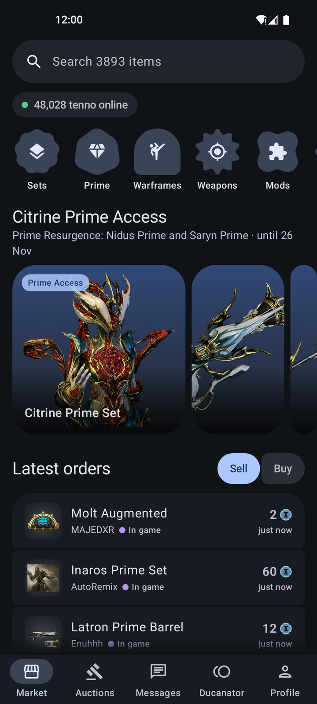
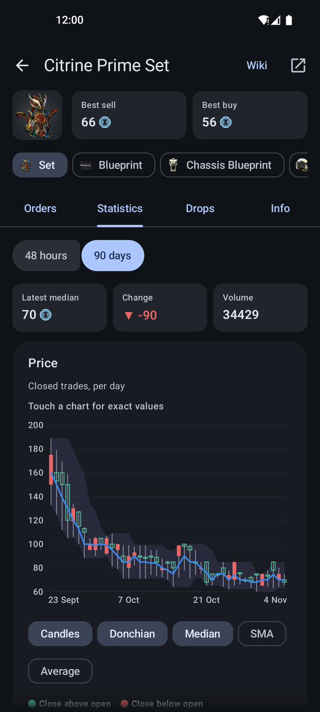
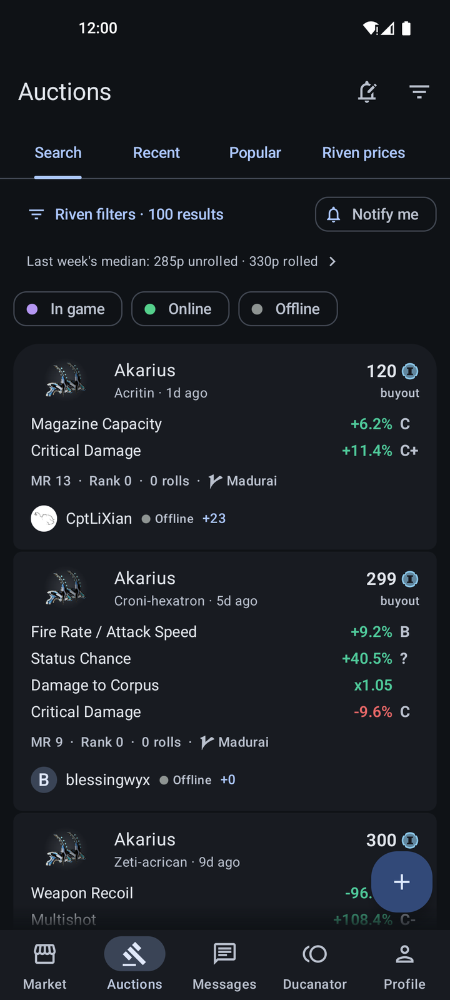
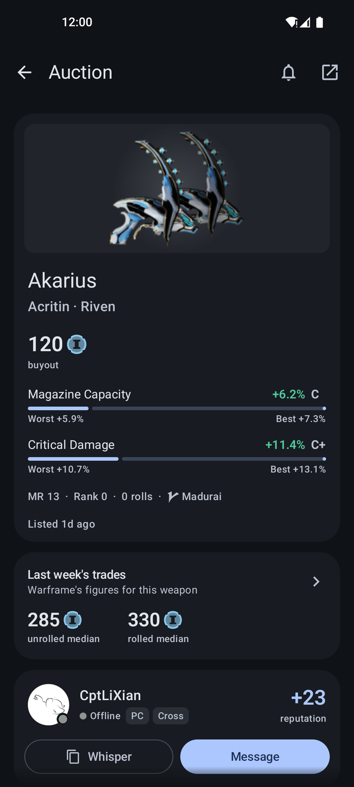

<div align="center">


# Warframe Market

A native Android client for [warframe.market](https://warframe.market), built with Jetpack Compose
and Material 3 Expressive. Browse and post orders, trade rivens with per-stat grades, chat with
traders and keep your status up, all from your phone.

[](https://github.com/orrnithogalum/wfmarket-android/releases/latest)
[](https://github.com/orrnithogalum/wfmarket-android/actions/workflows/ci.yml)
[](LICENSE)


</div>

<p align="center">
  
  
  
  
</p>

> [!NOTE]
> Warframe Market is an unofficial client. It isn't affiliated with warframe.market or Digital Extremes.

## Contents

- [Features](#features)
- [Requirements](#requirements)
- [Download](#download)
- [Updates](#updates)
- [Building](#building)
- [Releasing](#releasing)
- [Privacy](#privacy)
- [License](#license)

---

## Features

**Market**

- Search all 3,800+ tradeable items, or browse them by category
- Item pages with every order, filtered by whether the trader is in game, online or offline
- 48-hour and 90-day price history: candles, Donchian channel, median and moving averages
- Relic drop chances, set contents and ducat values
- Post and edit your own orders, mark them sold, or remove them

**Auctions**

- Rivens, lich weapons and sister weapons, with the site's search filters plus a price range and seller status
- A grade from S to F beside each riven stat, and a bar on the auction's page showing where in its range it rolled
- Hold a riven to see it at a glance, with *Find similar* for pricing it
- Warframe's own weekly riven trade figures for every weapon, kept week after week
- Saved searches that notify you of new listings, and followed auctions that notify you of new bids
- Create and edit auctions, with stats graded as you type

**Trading**

- Trade chat, with replies and *Mark as read* straight from the notification
- Swipe actions in the inbox, chosen per direction
- Set your status to In game, Online or Invisible for as long as you choose, and keep it while the app is closed
- The Ducanator: the best ducats for your platinum
- Player profiles with reviews, trade history and achievements

**The app**

- Material 3 Expressive, with your wallpaper's colors or its own pastel blue, and an AMOLED black option
- warframe.market links open in the app, and launcher shortcuts open your messages, search auctions, start one or set you In game

---

## Requirements

- Android 12 or newer
- A warframe.market account for anything beyond browsing. Signing in uses your site email and
  password. Accounts that sign in with Steam, Xbox or Discord need an email and password added on
  the website first.

---

## Download

Download `wfmarket-<version>.apk` from the [latest release](https://github.com/orrnithogalum/wfmarket-android/releases/latest)
and open it on your phone. Android asks once to allow installs from your browser or file manager.

Each release also has a `.sha256` file to check the download against:

```bash
sha256sum -c wfmarket-<version>.apk.sha256
```

Each release also carries a signed record of the commit and workflow it was built from. With the
[GitHub CLI](https://cli.github.com), check it with:

```bash
gh attestation verify wfmarket-<version>.apk -R orrnithogalum/wfmarket-android
```

> [!WARNING]
> Google Play Protect may block Warframe Market as a harmful app. It does that with apps it hasn't
> seen before that come from outside Google Play, especially ones that can install their own
> updates. To install it anyway, tap **More details**, then **Install anyway**. Every release is
> built from this repository's source by the [release workflow](.github/workflows/release.yml), and
> you can [build it yourself](#building) instead.

---

## Updates

Update from inside the app: when a new version is out, it appears at the top of **Settings**, ready
to install. **Settings › Updates** has a button to check now.

---

## Building

You need [JDK 17](https://adoptium.net) and the [Android SDK](https://developer.android.com/studio).
Android Studio includes both.

1. Clone the repository:

   ```bash
   git clone https://github.com/orrnithogalum/wfmarket-android.git
   cd wfmarket-android
   ```

2. Build the debug APK, or install it straight onto a phone connected with USB debugging:

   ```bash
   ./gradlew :app:assembleDebug   # the APK is in app/build/outputs/apk/debug/
   ./gradlew :app:installDebug
   ```

   The debug build installs beside a release one, as *Warframe Market debug* with a green icon.

3. Run the checks CI runs:

   ```bash
   ./gradlew :api:test :app:testDebugUnitTest :app:lintDebug :api:detekt :app:detekt
   ```

   `./gradlew :api:test -Plive` adds the contract tests against the live site. Set `WFM_EMAIL` and
   `WFM_PASSWORD` to include the signed-in ones, which remove whatever they create.

A release build without the release key is signed with your debug key instead. How the app talks to
the site, keeps your status and grades rivens is written up in [docs/internals.md](docs/internals.md).

---

## Releasing

Development happens on `master`, and `main` follows the latest release.

1. Bump `versionCode` and `versionName` in [`app/build.gradle.kts`](app/build.gradle.kts) and commit.
2. Tag that commit and push the tag. The tag's message becomes the release notes. Without one,
   they're built from the [Conventional Commits](https://www.conventionalcommits.org) since the
   last release.

   ```bash
   git tag -a v0.1.0 -m "What changed, in Markdown"
   git push origin v0.1.0
   ```

3. The [release workflow](.github/workflows/release.yml) tests, builds, signs and verifies the APK,
   then attaches it to a **draft** release. Publishing the draft is what makes the app offer it.

Signing reads the keystore from four repository secrets, listed at the top of the workflow. To sign
release builds locally, put the same values in `~/.gradle/gradle.properties`:

```properties
wfmarket.signing.storeFile=/path/to/release.jks
wfmarket.signing.storePassword=…
wfmarket.signing.keyAlias=…
wfmarket.signing.keyPassword=…
```

Alongside releases, [CI](.github/workflows/ci.yml) runs on every push and pull request: the unit
tests with coverage, Android Lint and [detekt](https://detekt.dev) (their findings go to code
scanning), and the debug and release builds. Pull requests also get their title and any new
dependencies [checked](.github/workflows/pr.yml). A [weekly job](.github/workflows/contract.yml)
runs the contract tests against the live site to catch API changes early, and Dependabot proposes
dependency updates monthly.

---

## Privacy

Warframe Market talks to warframe.market, to Warframe's public data for riven figures and the
current Prime Resurgence, and to GitHub for updates. There are no analytics, ads or crash
reporters. Your password goes only to warframe.market and isn't stored. The session token it
returns is encrypted with a key that stays in the Android Keystore.

---

## License

Warframe Market is free software, licensed under the [GNU Affero General Public License v3.0](LICENSE).

Warframe, its art and its item names belong to Digital Extremes. The app's icon is a simplified
redraw of the warframe.market logo, which belongs to warframe.market, and its polarity symbols are
Digital Extremes' art.
